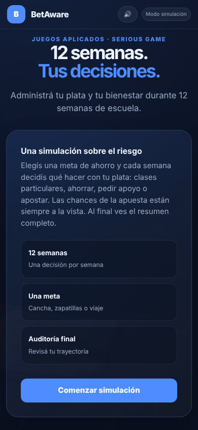
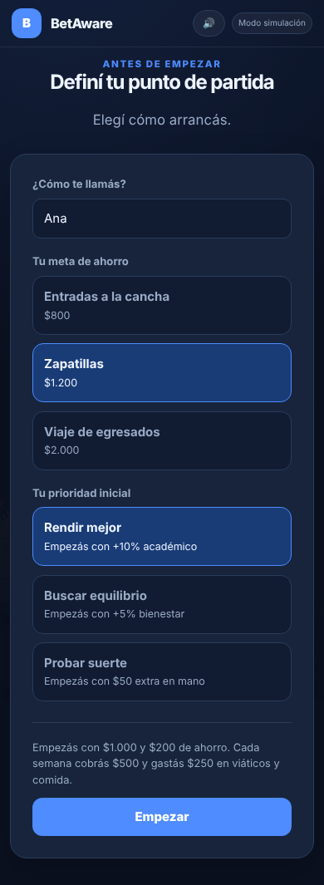
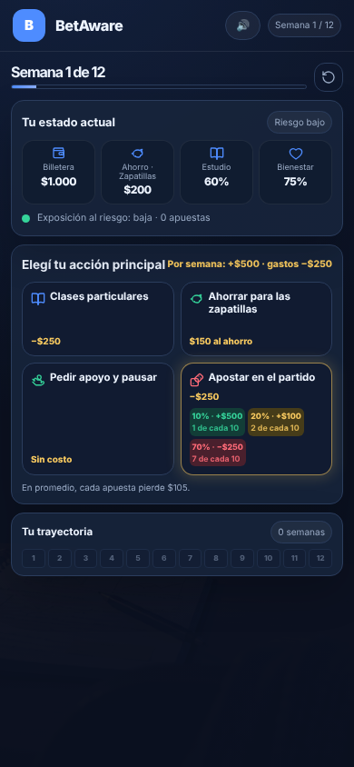
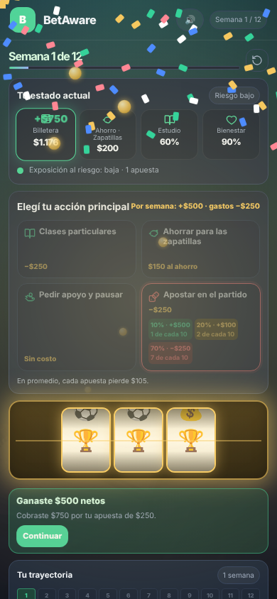
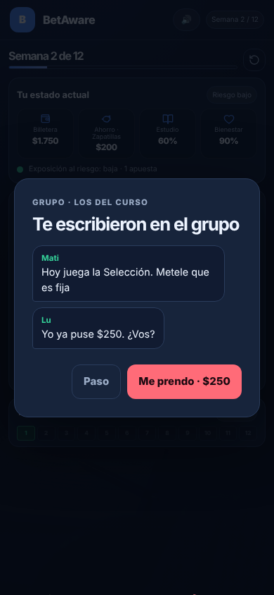
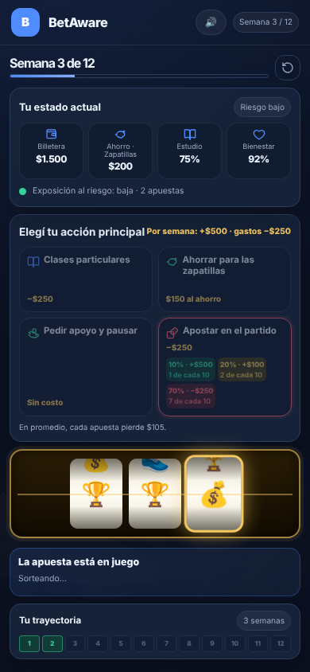
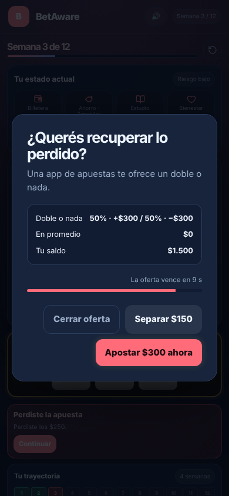
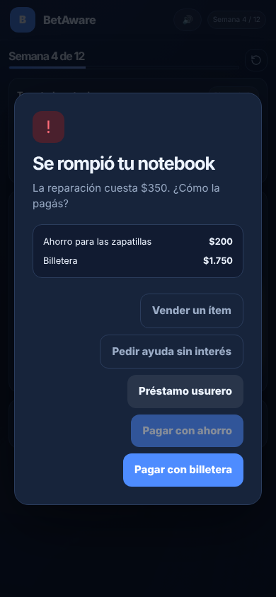
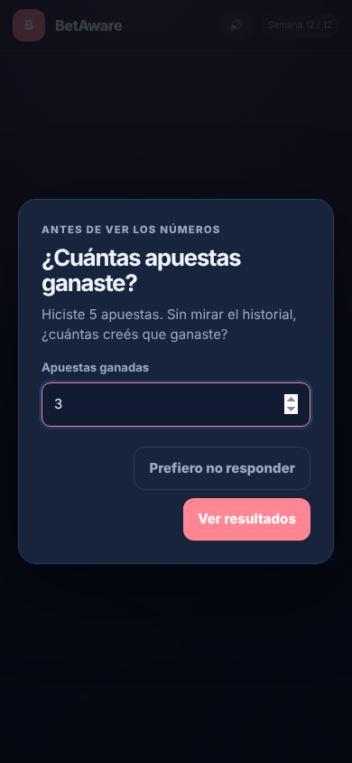
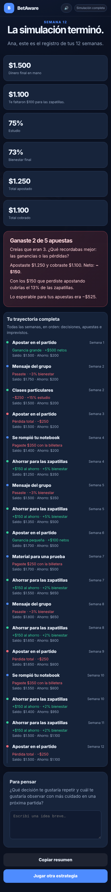

# BetAware: actualización y estado del proyecto

**Fecha:** 26 de octubre de 2026
**Grupo 4:** Guerrero Gabriel Omar, Garcia Diaz Ramiro, Delocca Franco, Franco Drogo
**Cátedra:** Diseño de Juegos Aplicados (UADE), con la Facultad de Psicología

Este documento resume qué cambió en el prototipo desde la Sprint Review, qué falta y cuáles son los próximos pasos. El detalle punto por punto está en [`revision.md`](revision.md). Los cambios de texto que necesita el informe están en [`informe-cambios.md`](informe-cambios.md).

## Versión jugable

- **Repositorio:** https://github.com/BrigabG/BetAware, rama `main`. La versión del juego descripta acá es la del commit `2f1b4f1`.
- **Cómo jugar:** descargar el repositorio (botón **Code → Download ZIP**) y abrir `index.html` en un navegador. No hace falta instalar nada ni tener conexión.
- **Enlace web:** todavía no hay. Se puede publicar con GitHub Pages desde **Settings → Pages**, eligiendo la rama `main` y la carpeta raíz. Si el repositorio es público, el juego queda en `https://brigabg.github.io/BetAware/`.

## Resumen

Se corrigieron todos los errores que marcó la Sprint Review y se agregaron las cuatro mejoras del backlog: probabilidades como frecuencias, metas concretas, presión de pares y la explicación del doble o nada. Además, la economía cambió: $500 de ingreso y $250 de gastos fijos por semana. Hoy el prototipo cubre el recorrido completo, Introducción → 12 semanas → Cierre, en celular y en computadora.

## Cambios realizados

### Pedidos de la Sprint Review

| Pedido | Qué se hizo |
|---|---|
| Corregir el retorno esperado | El juego decía "retorno de $160, pérdida de $90". Ahora muestra "En promedio, cada apuesta pierde $105" (cobro esperado: 0,10 × $750 + 0,20 × $350 = $145). |
| Aclarar etiquetas | Se sacó "Presupuesto libre". El cierre usa "Estudio" y "Total cobrado", como el informe. |
| Probabilidades como frecuencias | Debajo de cada porcentaje aparece "1 de cada 10", "2 de cada 10" o "7 de cada 10". |
| Metas concretas | Al empezar se elige una meta de ahorro: entradas a la cancha ($800), zapatillas ($1.200) o viaje de egresados ($2.000). |
| Presión de pares | En las semanas 2, 5 y 8 escribe el grupo del curso para que apuestes. |
| Explicar el doble o nada | La oferta muestra "En promedio: $0", separada de la apuesta principal. |

### Economía

- Cada semana se cobran $500 y se pagan $250 de gastos fijos (viáticos y comida). Quedan $250 para una acción. Antes la billetera crecía sin límite y se terminaba con más de $4.000.
- En los imprevistos se elige pagar con el ahorro (y alejarse de la meta) o con la billetera.
- La deuda se paga entera con el ingreso de la semana siguiente. Antes se descontaba toda la deuda cada semana, pero bajaba solo $40.

### Cierre

- Antes de ver los números, el juego pregunta cuántas apuestas cree el jugador que ganó. Se puede no responder y no puntúa.
- El cierre muestra lo que creía, lo que ganó, lo apostado, lo cobrado, el neto y lo esperable para esas apuestas.
- Dice si se llegó a la meta y qué parte de la meta se fue en apuestas.
- Muestra la trayectoria completa, semana por semana, incluidos imprevistos y mensajes del grupo.
- No tiene sonido ni efectos, para que contraste con las apuestas.

### Texto

- Cada pantalla muestra el dato en una línea, sin explicaciones repetidas ni moralejas. La regla quedó escrita en `AGENTS.md`.
- Se cambió el vocabulario universitario ("cuatrimestre", "finales", "liquidez") por el de secundaria. "Invertir en estudio" pasó a ser "Clases particulares".
- La pausa de la semana 11 ya no supone que el jugador perdió el control: pregunta "Si arrancaras de nuevo, ¿apostarías igual?".

### Estímulos de casino

Imitan los de una app de apuestas. No cambian las probabilidades.

- Tragamonedas de tres rodillos que frenan de a uno, con anticipación si los dos primeros coinciden.
- "Casi gano" en el 40% de las derrotas: el trofeo queda justo arriba de la línea (Clark, 2010).
- Monedas que vuelan a la billetera, contador, confeti y vibración al ganar.
- Botón de apostar que brilla y muestra la racha.
- La oferta de doble o nada vence en 10 segundos.
- Botón de sonido para el aula. Con "reducir movimiento" activado no hay partículas.

### Errores corregidos

- Los imprevistos se podían esquivar haciendo clic fuera del cuadro.
- Aparecía un botón "Continuar" que no hacía nada.
- El mensaje del imprevisto decía "el ahorro funcionó" aunque se pagara con la billetera.

## Capturas

Tomadas en un celular de 390 px de ancho. Los resultados de las apuestas fueron forzados para mostrar cada caso.

| | |
|---|---|
|  Inicio |  Elección de meta |
|  Una semana |  Premio grande |
|  Presión de pares |  "Casi gano" |
|  Doble o nada |  Imprevisto |
|  Pregunta antes del cierre |  Cierre |

En la partida del cierre, al jugador le faltaron $100 para las zapatillas y perdió $150 apostando.

## Pendientes

| # | Pendiente | Detalle | Responsable | Fecha |
|---|---|---|---|---|
| 1 | Actualizar el informe | OE 2, secciones 4.6 y 5.2 a 5.7, y una sección nueva sobre estímulos. Texto listo en [`informe-cambios.md`](informe-cambios.md). | _a definir_ | _a definir_ |
| 2 | Actualizar la matriz de congruencia | Columna "Mecánicas" e "Iteraciones" (ver `informe-cambios.md`). | _a definir_ | _a definir_ |
| 3 | Corregir el análisis transmedia | Dice "Unity WebGL"; el juego ya es web, en HTML y JavaScript. | _a definir_ | _a definir_ |
| 4 | Revisión con Psicología | Mensajes del grupo, costo de pasar (−3% de bienestar) y preguntas de las pausas. | _a definir_ | _a definir_ |
| 5 | Verificar la Línea 141 | Confirmar en la fuente oficial de SEDRONAR que atiende consultas por apuestas, y citarla. | _a definir_ | _a definir_ |
| 6 | Registro de la sesión | Descarga en CSV de decisiones, tiempos y finalización, para el facilitador del playtest. | _a definir_ | _a definir_ |
| 7 | Cuestionario pretest/postest | Ítems de los tres sesgos, lectura de probabilidades y un caso nuevo (informe 6.2). | _a definir_ | _a definir_ |
| 8 | Protocolo de playtest | Guion de la sesión, pensamiento en voz alta y planilla de observación (matriz, "Criterios comunes"). | _a definir_ | _a definir_ |
| 9 | Consentimiento | Autorización de la escuela y consentimiento de familias, porque los participantes tienen de 13 a 17 años. | _a definir_ | _a definir_ |
| 10 | Kit docente | Guía de clase y preguntas para después de jugar (análisis transmedia). | _a definir_ | _a definir_ |
| 11 | Sprites propios | Seis símbolos de 128×128 para los rodillos. Hoy son emojis y cambian según el sistema. | _a definir_ | _a definir_ |
| 12 | Enlace web | Publicar con GitHub Pages. | _a definir_ | _a definir_ |

## Próximos pasos

| Etapa | Qué incluye | Pendientes | Responsable | Fecha |
|---|---|---|---|---|
| Cerrar documentos | Informe, matriz y análisis transmedia alineados con el juego | 1, 2, 3, 5 | _a definir_ | _a definir_ |
| Preparar el playtest (OE 3) | Registro, protocolo, cuestionario, consentimiento y revisión de Psicología | 4, 6, 7, 8, 9 | _a definir_ | _a definir_ |
| Playtest piloto (OE 3) | 15 a 20 estudiantes de CABA, con observación y pensamiento en voz alta | — | _a definir_ | _a definir_ |
| Medición (OE 4) | Pretest y postest; meta: +25% relativo en ilusión de control | — | _a definir_ | _a definir_ |
| Material de cierre | Kit docente, sprites y enlace web | 10, 11, 12 | _a definir_ | _a definir_ |

## Para observar en el playtest

- **Estímulos.** Si la tragamonedas y los premios tapan la lectura del neto en el cierre. Conviene comparar sesiones con sonido y sin sonido.
- **Pausas.** Se cierran solas a los 7 o 9 segundos; hay que ver si alcanza para leer.
- **Billetera.** Quien ahorra todas las semanas suma $100 por semana en la billetera; hay que ver si eso confunde con el ahorro de la meta.
- **Presión de pares.** Si "Paso" (−3% de bienestar) se siente como un costo real o se ignora.
